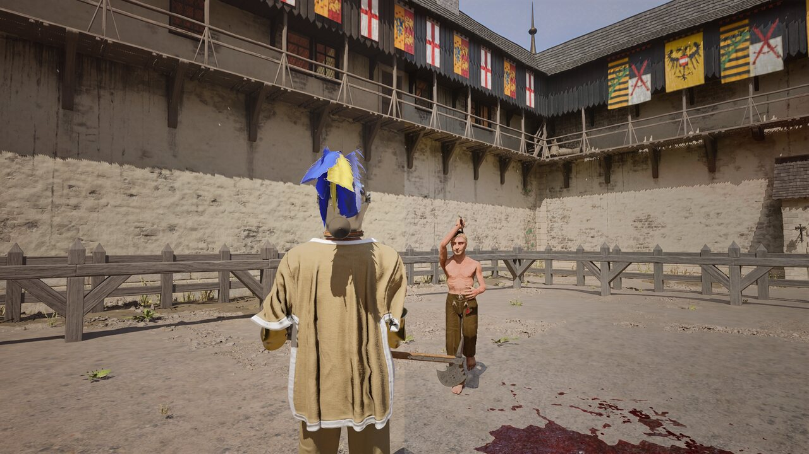
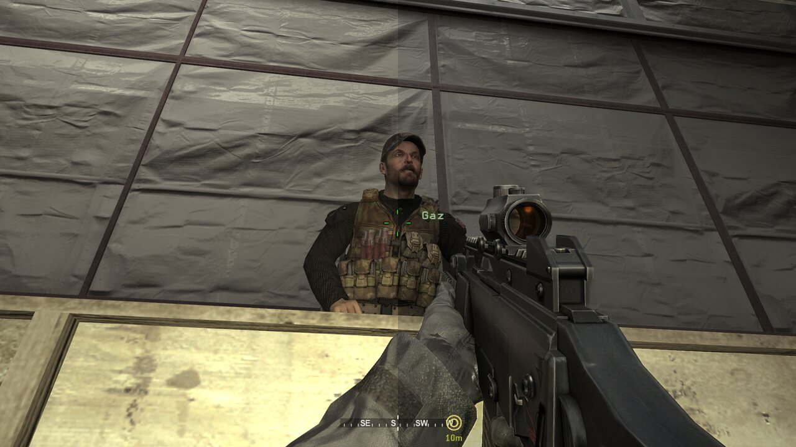
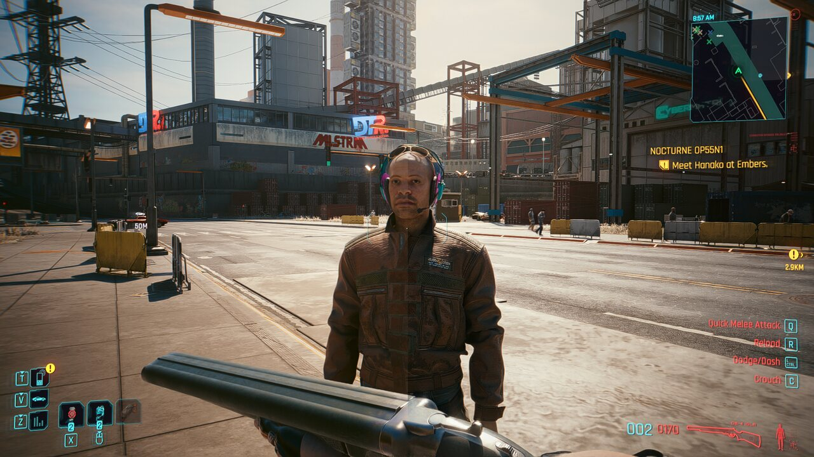

## Runtime safety improvements

Runtime SDK DLL imports use verification and atomic replacement. Graphics hooks, guide capture, and external-host compatibility improvements are included.

# UniversalDLSS5

**Current version:** v0.5.0

**Status:** Experimental Windows graphics injector/controller

UniversalDLSS5 is an experimental project that brings NVIDIA DLSS Neural Rendering / Feature 18 to games and applications that do not expose the feature natively. It hooks the game's presentation API, builds the required color/temporal inputs, executes the neural path, and composites the result back into the original renderer.

> UniversalDLSS5 is an independent open-source project and is **not affiliated with, sponsored by, or endorsed by NVIDIA**.

## Current renderer support

| Renderer | Current path |
| --- | --- |
| Direct3D 12 | Native fast path or late-attach recovery path |
| Direct3D 11 | Native fast path |
| Direct3D 10 / 10.1 | Compatibility frontend |
| Direct3D 9 / 9Ex | Compatibility frontend, including 32-bit games |
| OpenGL | Windows OpenGL compatibility frontend |
| Vulkan | Win32/Vulkan compatibility frontend |

Modern D3D11/D3D12 games that already work stay on their existing low-latency path. Legacy or unusual renderers are routed through compatibility frontends only when needed.

For **32-bit** games, the x86 bridge captures the renderer while the real Feature 18 work runs in the 64-bit `UniversalDLSS5.NRHost.exe` process.

## Features

- D3D9, D3D10, D3D11, D3D12, OpenGL and Vulkan renderer routing.
- x86 game support through the x64 Feature 18 host.
- UE5-safe late-attach D3D12 recovery used by games such as Half Sword.
- Automatic detach when the target application exits.
- Safer quiescent manual detach.
- Real Feature 18 GPU timing in diagnostics.
- Game-provided motion/depth support where lifetime is safe.
- Late-attach D3D12 recovery no longer injects cross-queue waits or mutates game command lists. Present-safe Streamline guides are used directly; shorter-lived Streamline depth/motion can be snapshotted by an injector-owned command list submitted immediately after the provider list on the same D3D12 queue.
- **1x-4x NR passes** work on both in-process and x64 NRHost routes; passes above 1 use a separate reset-only refinement feature with scratch ping-pong.
- NVOFA, camera/depth and HLSL optical-flow fallbacks remain available when native game guides cannot be used safely.

## Screenshots

<p align="center">
  
  
  
</p>

Additional captures are included under [`docs/images`](docs/images/).

## Temporal inputs

UniversalDLSS5 prefers reliable game data when available:

- game motion vectors from safe Streamline/NGX/native routes;
- game depth with detected depth convention;
- camera matrices when available;
- NVIDIA Optical Flow as the universal motion fallback;
- HLSL optical flow and zero-motion fallback modes.

For late-attached D3D12 recovery, guide capture stays generation-tracked. Present-safe Streamline resources are used directly. Shorter-lived Streamline depth/motion are kept only as non-owning metadata until the provider command list is submitted, then copied into UniversalDLSS5-owned textures by a separate command list appended to that same queue. NGX transient resources and heuristic game-owned resources remain excluded from recovery. If recovery D3D11 work is still outstanding, the frame is bypassed safely instead of blocking Present for several seconds.

The **NR passes** control supports 1x-4x processing on both direct and external-host routes. Pass 1 is temporal; additional passes use a separate reset-only refinement feature and local scratch resource.

## Installation

1. Download or build UniversalDLSS5.
2. Start `UniversalDLSS5.exe`.
3. Open the **NVIDIA Runtime** setup page and choose **Import NVIDIA SDK**.
4. Point UniversalDLSS5 at an official NVIDIA SDK/runtime package containing `nvngx_dlssnr.dll`.
5. Use **Launch and attach...** to choose the game's executable. Wait for **Neural Active** in its startup/menu scene before loading gameplay. This lets neural GPU allocations initialize before game streaming fills VRAM.
6. For an application that is already running, select its process and use **Attach**. Starting the neural host after VRAM is full can be substantially slower.

NVIDIA proprietary runtime binaries are **not distributed** in this repository. See [`docs/NVIDIA_RUNTIME_SETUP.md`](docs/NVIDIA_RUNTIME_SETUP.md).

## Usage and diagnostics

The controller exposes renderer route, source API, game/process architecture, motion source, depth source, queue confidence, Feature 18 status, GPU time and external-host state.

You can also start the controller with `UniversalDLSS5.exe --launch "C:\path\game.exe"`. It uses that executable's saved profile and working directory. Only one controller can own the shared settings at a time; a second instance exits with Windows code 183. Use the existing controller's launch button when it is already open.

For D3D12 with **External host**, the shared-resource path uses owned motion/depth snapshots and completes the composite before Present, including when the presenting queue was captured at startup. Keep **Neural passes** at **1x** for a single evaluation per frame.

Logs are written under:

```text
%LOCALAPPDATA%\UniversalDLSS5\logs\
```

If a game fails, the attach/crash log is the most useful file to include with a bug report.

## Compatibility notes

UniversalDLSS5 is still experimental. Compatibility depends on swapchain behavior, anti-cheat/protected processes, renderer synchronization, HDR format, driver/runtime versions and game-specific resource lifetimes.

- Native D3D11/D3D12 games do not pay legacy compatibility overhead.
- Late-attach D3D12 recovery uses an isolated same-adapter D3D12/D3D11 transport and the x64 NRHost.
- Classic D3D9 may require a more expensive full-resolution compatibility transfer than modern APIs.
- Protected or anti-cheat processes may reject injection entirely.

Because the project uses DLL injection and graphics API hooks, some **antivirus** products may report heuristic detections. Verify release hashes and obtain builds from the official repository.

## Build

Requirements: Windows 10/11, Visual Studio 2022 with C++ tools, CMake, NVIDIA GPU/driver, and the required NVIDIA SDK/runtime files.

Build the Windows binaries:

```bat
BUILD_WINDOWS.bat
```

Build the release package/installer:

```bat
BUILD_RELEASE.bat
```

The build produces x64 components plus the x86 bridge/injector required for 32-bit games.

## Documentation

- [`docs/V0.4.4_RELEASE.md`](docs/V0.4.4_RELEASE.md) — current release notes
- [`docs/NVIDIA_RUNTIME_SETUP.md`](docs/NVIDIA_RUNTIME_SETUP.md) — NVIDIA runtime import/setup
- [`docs/GAME_GUIDES_SAFE_ATTACH.md`](docs/GAME_GUIDES_SAFE_ATTACH.md) — temporal-guide and safe-attach notes
- [`docs/V0.4.0_RELEASE.md`](docs/V0.4.0_RELEASE.md) — renderer compatibility architecture

## License

UniversalDLSS5 is licensed under the **Apache License 2.0**. See [`LICENSE`](LICENSE).

Copyright 2026 MotionflowOffical.
